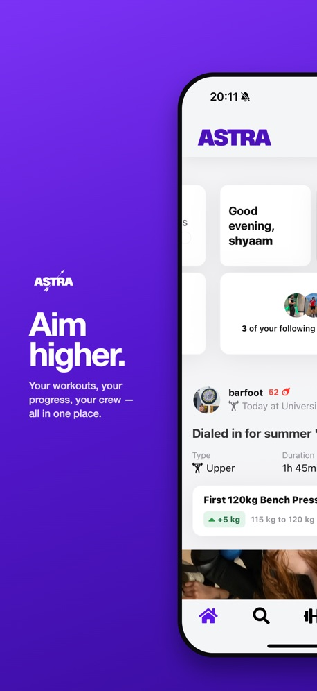
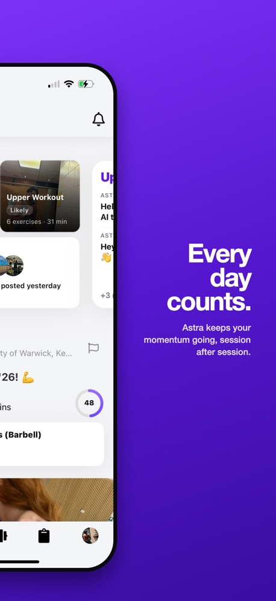
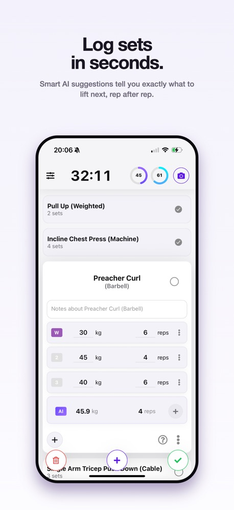
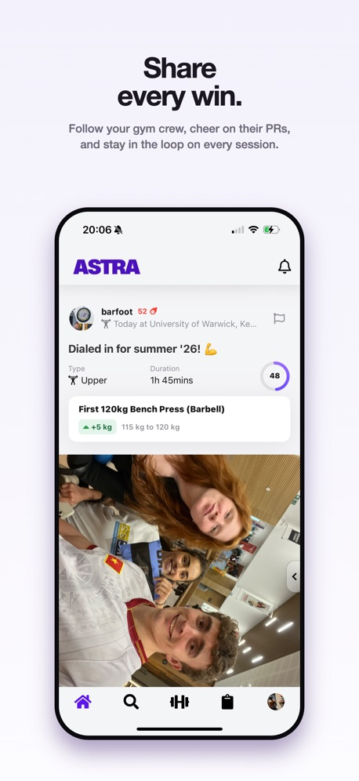

# Astra Lifters

A gym tracking app with a social feed. **[Download on the App Store](https://apps.apple.com/gb/app/astra-lifters/id6751715759)**

  
  
  
  

> The source code is private. This page describes the product.

## Why I built it

The gym apps I used put basic features behind a paywall, at which point pen and paper does the same job. They also ignored the two things that keep people training: other people, and seeing progress.

## What it does

- **Workout tracking.** Log sets, reps and weights quickly, with suggested weights and reps based on your last session.
- **Social feed.** Post a workout with a photo and caption, follow friends, and save their routines. People stay consistent when someone is watching.
- **Astra Power Score.** Compares each session with your recent ones, so you can tell when you have progressed.
- **Muscle Score.** Shows which muscles each workout trained, so you can spot gaps.
- **No paywall.** Every feature, including your full history, is free.

## Usage

Read from the production database on 24 August 2026:

| | |
|---|---|
| Registered users | 783 |
| Workouts logged | 5,793 |
| Posts | 5,411 |
| Users with 50 or more workouts | 41 |

Signups peaked at 253 in February 2026, during an Instagram campaign I ran myself.

## How it was built

React Native and Firebase. I learned React Native to build the first version and tested it on friends through TestFlight, fixing what they found. AI coding tools did much of the work that took it from that version to App Store quality. I made the product decisions and ran every release.
