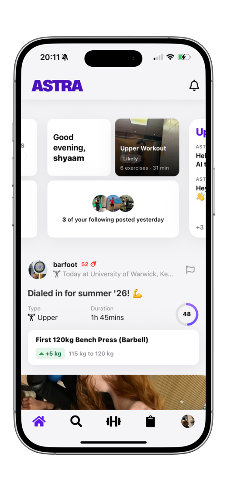
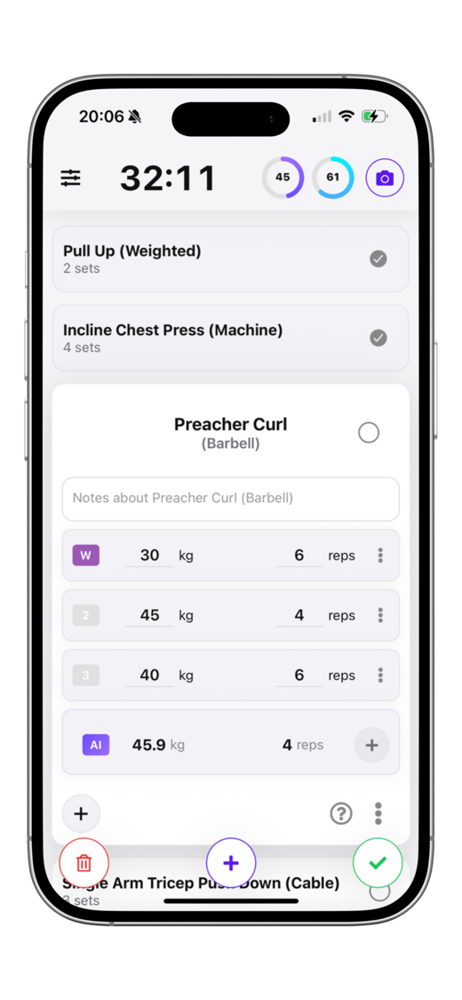
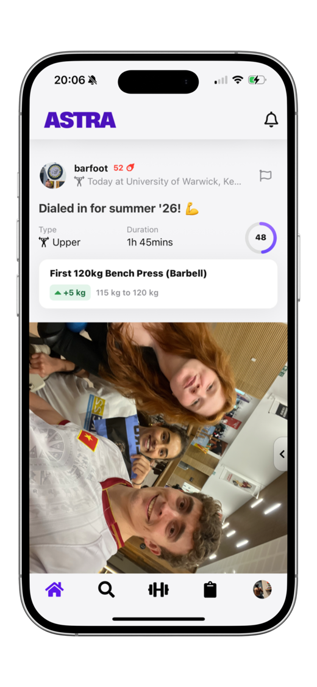
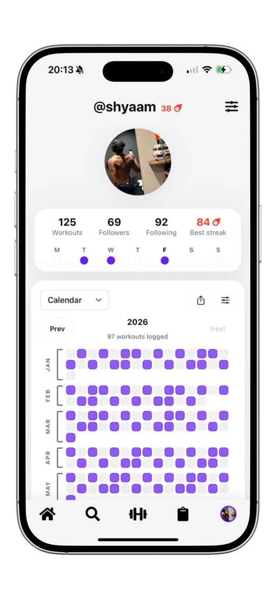
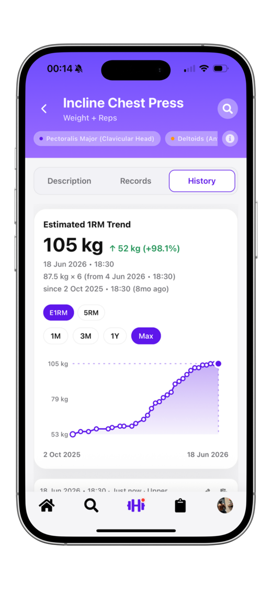
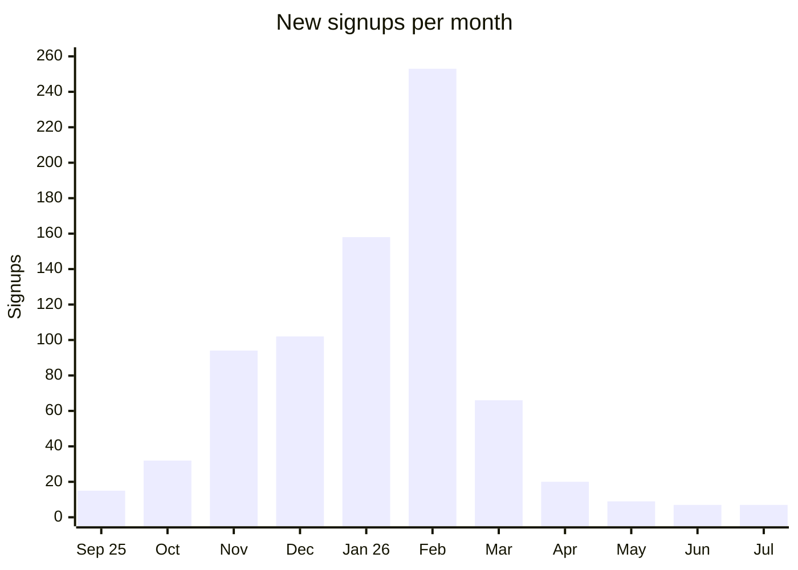

# Astra Lifters

A social gym app for people who want to get stronger. **[Download on the App Store](https://apps.apple.com/gb/app/astra-lifters/id6751715759)**

  
  
  
  
  

> The source code is private. This page describes the product.

| Registered users | Workouts logged | Posts shared |
|:---:|:---:|:---:|
| **794** | **6,577** | **6,155** |

Read from the production database on 11 October 2026.

## Why I built it

I was logging my training in StrengthLog and the Notes app. The apps put features I thought were basic behind a paywall, at which point pen and paper does the same job. They also ignored the two things that keep people training: other people, and seeing progress.

Astra started as a venture idea in my Entrepreneurship in Practice module at Warwick. I built it around three ideas:

1. **Consistency.** People keep showing up when friends can see whether they did.
2. **Progressive overload.** You get stronger by doing slightly more than last time, so the app should tell you what "slightly more" is.
3. **Knowledge.** Most beginners don't know which muscles a workout trained or what they missed.

## What it does

### Log a workout in seconds

Sets, reps and weights on one screen, with your last session in front of you. Astra suggests the weight and reps for your next set based on what you did before, so you don't have to work it out between sets. You can save routines, create your own exercises and reuse any past workout with the weights adjusted.

### Share it

Finishing a workout creates a post with a photo, a caption and your personal bests from that session. Friends see it in their feed. You can follow other lifters, comment, and save someone else's workout to try yourself.

### Astra Power Score

Every workout gets a score that compares it with your recent sessions. A higher score means you pushed harder than usual, so you can tell at a glance whether you progressed.

### Muscle Score

Shows which muscles each workout trained and which you have been missing, then recommends an exercise to fill the gap.

### Streaks and history

A streak counts your training days and survives up to two rest days in a row, because a streak that breaks on a planned rest day teaches the wrong habit. Your profile shows a calendar of every session, and each exercise has a chart of your estimated one-rep max over time.

### Referrals

Each user can share an invite link, and the app tracks who joined through it. 35 people have signed up this way.

### No paywall

Every feature is free, including your full history.

## Growth

Astra went from 31 users at the end of September 2025 to 670 by the end of February 2026.

Most of the February peak came from an Instagram campaign I ran myself, posting daily. The best day was 25 February 2026, with 96 signups, and about 192 people joined over four days. I planned 30 days of posts and stopped at around day 21. Signups fell from 253 in February to 66 in March.

That drop taught me growth was coming from the campaign, not from the product spreading by itself. The users who stayed are the more encouraging number: by August 2026, 41 people had each logged 50 or more workouts, and 51 were still active that month with no marketing since February.

## Running it

I built a separate admin dashboard to run the app day to day. It shows signups, active users and workout analytics, a referral leaderboard, and a queue for reported posts, and it sends push notifications.

## How it was built

- **App:** React Native with Expo, about 50 screens.
- **Backend:** Firebase (Firestore, Cloud Functions, Storage).
- **Admin dashboard:** React with Chart.js.

I learned React Native to build the first version, shared it with friends through TestFlight and fixed what they found. AI coding tools did much of the work that took it from that version to App Store quality. I made the product decisions and ran every release. Now that strangers use it, I test more carefully before each update.
